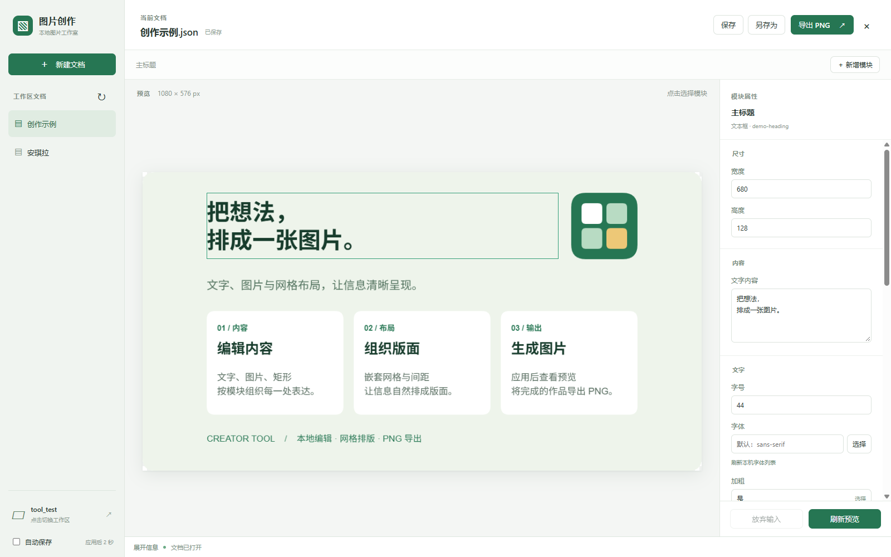

<div align="center">
  
  <h1>图片创作</h1>
  <p><strong>把想法，排成一张图片。</strong></p>
  <p>Creator Tool · 本地图片排版与 PNG 导出工具</p>
  <p>
    
    
    
    
    
  </p>
  <p>
    <a href="#主要功能">主要功能</a> ·
    <a href="#界面演示">界面演示</a> ·
    <a href="#安装与首次启动">安装与首次启动</a> ·
    <a href="#使用方法">使用方法</a> ·
    <a href="#卸载">卸载</a> ·
    <a href="#文档">文档</a>
  </p>
</div>

图片创作将文字、图片和矩形组织为模块，通过网格完成排版。你可以在桌面界面中编辑，也可以直接修改 JSON 文档，再预览并导出 PNG，适合制作说明卡片、信息长图和图文海报。

作品与素材保存在本地，每张图片对应一份独立的 JSON 文档。

## 主要功能

<table>
  <tr>
    <td width="50%">
      <strong>文字、图片与矩形</strong><br />
      在属性面板中编辑内容、尺寸、字体、颜色、背景、边框与圆角。
    </td>
    <td width="50%">
      <strong>网格与嵌套布局</strong><br />
      用行列、间距和内边距组织模块，支持新增、删除及调整父模块和位置。
    </td>
  </tr>
  <tr>
    <td>
      <strong>预览与 PNG 导出</strong><br />
      点击画布选择模块，应用修改后刷新预览，按设定的输出尺寸导出图片。
    </td>
    <td>
      <strong>工作区与模板</strong><br />
      按目录管理作品，从空白文档开始，或复制已有 JSON 模板继续创作。
    </td>
  </tr>
  <tr>
    <td>
      <strong>本地素材与系统字体</strong><br />
      通过系统窗口选择图片，保存时复制素材；支持选择本机已安装的字体。
    </td>
    <td>
      <strong>保存与文件保护</strong><br />
      支持手动保存、自动保存、未保存提醒，以及外部文件变化和渲染问题提示。
    </td>
  </tr>
</table>

## 界面演示

<p align="center">
  
</p>

<p align="center">
  <sub>当前桌面界面，使用仓库自带的「创作示例」。</sub>
</p>

## 安装与首次启动

### 安装

1. 前往 [GitHub Releases](https://github.com/leejkee/creator-tool/releases)，在所需版本的 Assets（附件）中下载 `CreatorTool_<版本>_windows_x64-setup.exe`，适用于 Windows x64。
2. 运行安装包，按安装向导完成安装。系统缺少 WebView2 时，安装器会联网下载并安装所需运行时。
3. 安装完成后可直接启动应用，也可以从开始菜单中的 `creator-tool-desktop` 启动；窗口名称为「图片创作」。

使用安装包无需安装 Node.js、Rust 或编译工具。若发布页尚无安装包，可以按[从源码运行](#从源码运行)启动应用。

### 首次启动

首次使用会弹出 workspace 目录选择窗口。请选择一个已有且具有写入权限的目录，建议在「文档」中建立独立的作品目录，用来保存 JSON、素材和导出的图片。

确认目录后，应用会实际创建临时子目录和文件进行写入检查，完成清理并成功扫描后才保存工作区设置。检查失败会显示原因；更换工作区时若检查失败，当前工作区和未保存内容会保留。

空工作区也可以使用，点击「新建文档」即可开始创作；自动保存可在左下角按需开启，字体和素材目录无需预先配置。

取消选择后会停留在欢迎页，点击「选择工作区」可以重试，未配置工作区时无法新建文档。

后续启动会重新检查并恢复已保存的工作区；启动时若原目录已移动、删除、不可写或无法扫描，会显示原路径及失败原因，并自动重新引导选择工作区。取消后仍可从欢迎页重试，也可以通过左下角的工作区按钮更换目录。

## 使用方法

1. **新建或打开作品**：点击左侧文档打开已有作品，或点击「新建文档」输入名称，也可以选择已有 JSON 模板。
2. **组织内容**：新增文字、图片、矩形或布局模块，并设置父模块与行列位置。
3. **编辑并应用**：在预览中点击模块，在右侧修改属性，点击「应用修改」更新文档与预览。
4. **保存作品**：点击「保存」，或在左下角开启自动保存。新选择的图片会在保存时复制到当前文档目录。
5. **导出 PNG**：点击「导出 PNG」。图片保存在 JSON 同目录，文件名与 JSON 一致；已有同名图片时会提示是否覆盖。

仓库提供不依赖外部图片的[创作示例](desktop/examples/创作示例/创作示例.json)。下载后放入工作区的 `创作示例/创作示例.json`，刷新文档列表即可打开；从源码运行时，也可直接将 [desktop/examples](desktop/examples) 设为工作区。

### 工作区目录

文档必须是 `<目录>/<目录名>.json`，应用只扫描工作区的一级子目录。例如：

```text
我的工作区/
├─ 作品封面/
│  ├─ 作品封面.json
│  ├─ 配图.png
│  └─ 作品封面.png
└─ 说明卡片/
   └─ 说明卡片.json
```

只有其他名称 JSON 的目录不会出现在文档列表中。JSON 模板同样要求文件名与所在目录同名。

图片相对路径以 JSON 所在目录为基准。切换模块或文档前，按提示处理尚未应用、尚未保存的修改；保存和导出使用已应用的内容。底部信息区域会显示操作提示、错误和警告。

### 快捷键

| 快捷键 | 操作 |
| --- | --- |
| `Ctrl + S` | 保存已应用的修改 |
| `Ctrl + Shift + S` | 另存为 |
| `Esc` | 取消当前底部操作 |

## 卸载

先保存作品并退出应用，再通过以下任一入口卸载：

- 打开 Windows「设置 → 应用 → 已安装的应用」，找到 `creator-tool-desktop`，选择「卸载」。
- 在应用安装目录中运行 `uninstall.exe`。

卸载时默认保留应用配置与缓存，也可以勾选「删除应用数据」一并清理。单独存放的 workspace 目录不在程序卸载的清理范围中，作品 JSON、素材及导出的 PNG 会保留。

保留应用数据后重新安装，会恢复此前保存的工作区设置；删除应用数据后重新安装，则需要再次选择工作区。

## 从源码运行

目前面向 Windows 桌面使用。从源码运行前，准备 Node.js 22.12+、Rust 的 MSVC 工具链、Microsoft C++ Build Tools 和 WebView2。安装步骤见 [Tauri Windows 环境说明](https://v2.tauri.app/start/prerequisites/#windows)。

在项目根目录打开终端：

```powershell
cd desktop
npm ci
npm run tauri dev
```

需要安装包时，在 `desktop/` 下执行：

```powershell
npm run tauri build
```

生成的 Windows 安装包位于 `desktop/src-tauri/target/release/bundle/`。构建检查和发布操作见下方文档。

## 文档

- [文档格式与文件管理](docs/document.md)
- [布局、渲染与输出](docs/rendering.md)
- [素材、字体与图片处理](docs/resources.md)
- [开发环境与构建检查](docs/development.md)
- [CI/CD 与版本发布](docs/releasing.md)
