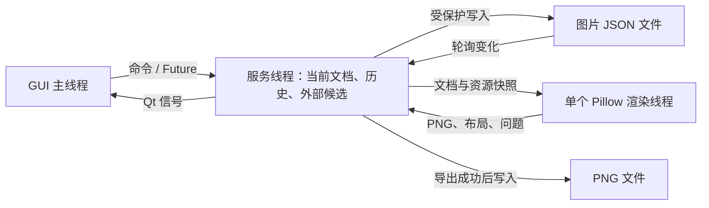

# 旧 Python 实现设计梳理（待废弃）

> **待废弃：仅供迁移核对旧实现。** 本文不描述当前 Tauri 架构；后续开发见 [开发说明](docs/dev.md)。文中的“当前实现”指下述梳理日期的 Python 实现。

本文件根据 `image_create_tool` 核心代码整理，不以已有产品文档作为行为依据。

- 梳理日期：2026-10-23。
- 代码版本标记：`v0.1.0`。
- 范围：JSON 图片描述、GUI 设计、全部图片状态修改来源、修改与合成执行函数。
- 验证方式：阅读核心代码；对 `:text` 更新和处理器简写做了内存调用核对。没有进行完整 GUI 验收。
- 本文记录当前实现；已发现的实现问题单独列出，不将其描述为预期设计。

## 1. 总体结构

当前方案用 JSON 保存一棵模块树，GUI 提交编辑命令，服务层维护文档、版本和文件同步，Pillow 根据文档快照完成布局与合成。



三个线程在同一进程中。服务层不依赖 Qt，模型层不依赖 Qt 或 Pillow。

主要代码分工：

| 文件 | 职责 |
|---|---|
| [model.py](image_create_tool/model.py) | 文档默认值、规范化、校验、编辑操作、三方合并 |
| [gui.py](image_create_tool/gui.py) | 界面、交互、编辑队列、预览展示 |
| [service.py](image_create_tool/service.py) | 文档状态、保存、历史、外部修改、渲染调度 |
| [renderer.py](image_create_tool/renderer.py) | Pillow 测量、布局、绘制、合成、PNG 编码 |
| [styles.py](image_create_tool/styles.py) | Style 展开与应用、Template 复制、资源保存 |
| [resources.py](image_create_tool/resources.py) | 文档加载、资源快照、资源变化核对 |
| [documents.py](image_create_tool/documents.py) | 新建文档、资源路径重定位 |
| [assets.py](image_create_tool/assets.py) | 素材索引、素材引用解析 |
| [preprocessing.py](image_create_tool/preprocessing.py) | 图片处理脚本的解析与执行 |
| [typography.py](image_create_tool/typography.py) | 字体路径解析 |
| [storage.py](image_create_tool/storage.py) | 受保护的 JSON 写入、PNG 写入、默认输出路径 |
| [settings.py](image_create_tool/settings.py) | 全局配置、资源目录、终端启动 |
| [contracts.py](image_create_tool/contracts.py) | 跨线程渲染请求与结果的数据结构 |

## 2. JSON 如何描述图片

核心定义在 [model.py](image_create_tool/model.py)，实际绘制解释在 [renderer.py](image_create_tool/renderer.py)。

### 2.1 文档结构

一份图片 JSON 的基本结构如下：

```json
{
  "image-create-tool-version": "v0.1.0",
  "documentId": "example-document",
  "revision": 0,
  "title": "图片名称",
  "sourceNotes": "原始资料",
  "assetsDir": "assets/",
  "composition": {
    "width": 1200,
    "height": "auto",
    "padding": 32,
    "gap": 24
  },
  "modules": [
    {
      "id": "module-1",
      "type": "group",
      "name": "内容区",
      "layout": {
        "type": "column",
        "gap": 16
      },
      "elements": [
        {
          "id": "text-1",
          "type": "text",
          "text": "需要绘制的文字",
          "style": {
            "fontSize": 28,
            "color": "#F2F0FA"
          }
        }
      ]
    }
  ]
}
```

文档分为三个层次：

| 层次 | 数据 | 实际职责 |
|---|---|---|
| 文档 | 版本标记、`documentId`、`revision`、`title`、`sourceNotes` | 文件识别、编辑同步、资料保存 |
| 整张画布 | `composition` | 总宽高、背景、外边距、顶层模块间距与顺序 |
| 模块树 | `modules` → `elements` | 实际绘制内容及其组合关系 |

顶层字段的关键行为：

- `image-create-tool-version` 必须存在，当前接受 `v0.0.1` 和 `v0.1.0`。
- `documentId` 标识文档；缺少时由规范化补齐。
- `revision` 用于编辑版本校验；缺少时补为 0。
- `title` 是文档名称，不会自动绘制为图片标题。
- `sourceNotes` 不参与绘制，GUI 也没有编辑它的入口。
- `assetsDir` 相对图片 JSON 所在目录解析，缺省为 `assets/`。
- `fonts` 可指定 `regular`、`bold` 等字体路径；实际字体选择由 `font_path()` 完成。
- `assetAliases` 保存素材相对路径到别名数组的映射。
- `outputsDir` 仍被校验和配置操作接受，但当前默认导出路径不使用它。

默认整图 PNG 路径为 JSON 同目录、同名的 `.png`。单节点导出使用附带节点 ID 的文件名。

### 2.2 模块与节点

模块与元素使用同一套节点结构。“模块”主要指 `modules` 中的顶层节点，没有独立的模块类；顶层也可以直接放文字、图片或矩形。

| 节点类型 | 内容 | 说明 |
|---|---|---|
| `text` | `text` | 文字换行、字体、颜色、对齐 |
| `image` | 素材引用 | 图片处理、裁剪、适配和缩放 |
| `rect` | 尺寸与样式 | 绘制矩形，可叠加圆角、边框 |
| `group` | `elements` | 容器，负责布局和递归合成 |
| `itemRow` | 旧结构的文字与图片 | 兼容输入，规范化后转成 `group` |

每个节点必须有全局唯一的非空 `id`。容器通过 `elements` 嵌套，叶子节点不能包含非空子节点。

普通编辑保留已有 ID；复制节点和实例化模板会为新子树生成 ID。外部 JSON 仍可能改变 ID，合并时会将其解释为节点增删。

### 2.3 尺寸、位置和布局

| 参数 | 实际含义 |
|---|---|
| `width`、`height` | 节点边界尺寸；缺省或 `"auto"` 使用自动计算 |
| `layout` | 容器如何安排直接子节点 |
| `position` | 子节点在网格中的 `[行, 列]` |
| `x`、`y` | 父容器采用 `fixed` 布局时的位置 |
| `offsetX`、`offsetY` | 在布局结果上追加偏移；GUI 拖动修改这两个字段 |
| `zIndex` | 同一父容器内的绘制顺序，不参与布局排序 |
| `visible` | 不可见节点及其后代不参与正常布局、绘制 |
| `locked` | GUI 拖动约束；模型层仍允许命令修改位置 |

布局支持：

| `layout` | 行为 |
|---|---|
| `{"type":"column"}` | 纵向排列 |
| `{"type":"row"}` | 横向排列 |
| `{"type":"grid","rows":2,"columns":3}` | 显式网格 |
| `[2,3]` | 网格简写，布局内边距与间距均为零 |
| `{"type":"fixed"}` | 按子节点 `x/y` 安排位置 |

对象形式还支持 `padding`、`gap`、`rowGap`、`columnGap`。

整张画布在渲染器内部也会转换成一个纵向 `group`。顶层合成实际是纵向布局；自由摆放需要在内部建立 `fixed` 容器。

`composition.moduleOrder` 可以显式指定顶层顺序，必须包含每个顶层节点且不重复；缺省时使用 `modules` 数组顺序。

自动尺寸规则：

- 文字按宽度逐字符换行，以行数和行高计算自然高度。
- 图片默认高度为 `min(可用宽度, 180)`，并非直接采用原图自然高度。
- 矩形默认高度为 60。
- 容器根据子节点计算高度。
- 显式设置宽高后，以指定边界为准。

### 2.4 样式

每个节点使用自身 `style`，没有父子样式继承。当前接受的视觉字段为：

```text
fontSize、font、bold、color、align、lineHeight、
background、radius、border、opacity
```

- `background` 可以是颜色字符串，也可以是 `solid`、`image`、`blur` 对象。
- 没有指定素材的 `blur` 背景会模糊当前位置已经合成的底图。
- `border` 控制边框颜色、宽度和可见性。
- `radius` 对当前节点合成图层应用圆角遮罩。
- `opacity` 调整当前节点整体透明度。
- 文字缺省样式由程序补齐；容器缺省没有背景、圆角等装饰。
- 容器的 `style.align` 也被用于子节点行的水平对齐。

字体优先级为：节点 `style.font` → 文档 `fonts` 中对应字重 → `fonts.regular` → 程序列举的系统字体。

Style 资源的字段范围大于节点的 `style` 对象，详见第 5 节。

### 2.5 素材、裁剪和处理脚本

图片内容有三种定位方式：

| 字段 | 解析方式 |
|---|---|
| `assetPath` | 优先使用；相对图片 JSON 所在目录解析 |
| `assetId` | 素材相对 `assetsDir` 的路径，不是随机生成的编号 |
| `assetQuery` | 按素材文件名或别名精确匹配，可附加目录分类 |

`assetAliases` 保存“素材相对路径 → 别名数组”。匹配出现零个或多个结果都会报错。GUI 搜索列表使用子串搜索，但渲染器的素材查询采用精确匹配。

图片处理顺序：

```text
读取素材 → 转 RGBA → 执行处理脚本 → crop 裁剪
→ fit 适配与 contentScale 缩放 → 裁到节点边界 → 合成
```

- `fit` 支持 `contain`、`cover`、`stretch`、`height`、`width`。
- `contentScale` 控制图片内部缩放；图片未固定宽度时，还可能影响其布局占用宽度。
- `crop` 的坐标基于脚本处理后的图片。
- 处理脚本既可以用于图片节点，也可以用于带素材引用的背景对象。

### 2.6 加载与规范化

JSON 读入后会经过 `normalize()` 和 Style 展开：

1. 补齐缺少的顶层默认值。
2. 将旧 `itemRow` 转为横向组合，保留 `:image`、`:text` 子 ID。
3. 将容器的旧 `title` 转为真正的文字子节点，并使用 `name` 保存名称。
4. 给网格子节点补齐 `position`。
5. 将版本统一为 `v0.1.0`。
6. 展开字符串形式的 Style 引用。

普通规范化先改变内存文档；打开文件时发现 Style 引用并展开，会立即写回 JSON，且不会因此增加 `revision`。

文档校验并不是完整的可渲染校验。素材、字体、脚本、裁剪边界及布局问题还会在资源收集和渲染阶段检查。

## 3. GUI 的设计思路

主体在 [gui.py](image_create_tool/gui.py)，状态管理在 [service.py](image_create_tool/service.py)。

### 3.1 三栏界面

| 区域 | 职责 |
|---|---|
| 左侧树 | 展示模块树，选择、新增、复制、删除、调整顶层顺序 |
| 中间画布 | 展示渲染后的 PNG，叠加选择框和拖动命中区域 |
| 右侧属性 | 修改文字、尺寸、偏移、可见性、样式、素材、裁剪等 |

画布展示整张渲染结果。文字、图片没有作为独立 Qt 图元现场绘制；可交互图元主要是透明命中框。

拖动时先移动命中框；松手后提交偏移修改，等待重新渲染。渲染器返回的 `layout.elements` 同时服务于 GUI 选中、命中、锁定判断，因此布局结果也是 GUI 的交互数据。

### 3.2 编辑命令与同步

- 属性修改经过 400 毫秒防抖，也可以点击“应用属性”。
- GUI 将编辑转成操作数组，经 `submit_ops()`、`pump_ops()` 串行提交。
- 服务通过 `base_revision` 拒绝基于旧文档发出的修改。
- 保存、导出、撤销重做等动作会先通过 `flush()` 提交尚未完成的属性编辑。
- 普通编辑成功后自动保存；“保存/重试”用于显式保存或重试失败写入。
- GUI 通过 `Future` 接收命令结果，通过 Qt 排队信号接收服务事件，避免在 GUI 线程等待后台执行。

### 3.3 预览与任务

- 界面提供“当前内容／外部候选／合并预览”三种模式。
- 后两种画布不创建编辑命中框；右侧操作仍针对当前文档。
- 切换文件、版本更新、外部候选变化时，服务使用 session、revision、candidate ID 丢弃过期预览。
- 预览任务按目标合并排队，当前预览、外部预览、合并预览各保留最新待执行任务。
- 渲染工作池只有一个 worker，预览与导出共用该执行通道。
- 导出任务单独排队，最多允许四个排队中或执行中的导出任务。

一些高级编辑入口直接让用户填写 JSON，例如画布、布局和完整样式参数。处理脚本没有专门的 GUI 配置面板。

## 4. 图片状态的全部修改来源

### 4.1 状态分类

“修改图片”涉及四种状态：

| 状态 | 内容 |
|---|---|
| 当前文档 | 节点、文字、样式、结构、版本 |
| 文件同步状态 | `baseline`、磁盘哈希、`dirty`、外部候选、撤销重做 |
| 渲染依赖 | 素材、字体、处理脚本、全局资源目录 |
| 界面与产物 | 选择、缩放、预览、任务状态、导出 PNG |

### 4.2 普通编辑：16 种模型操作

普通编辑进入 `model.apply_operations()`。当前共有 16 个操作名称：

| 操作 | 修改内容 | 当前 GUI 来源 |
|---|---|---|
| `set_composition` | 更新画布参数 | 画布设置 |
| `set_project_config` | 更新 `title/assetsDir/outputsDir` | 图片设置只提供前两项 |
| `add_module` | 添加顶层节点 | 添加模块 |
| `reorder_modules` | 更新顶层顺序 | 模块上移、下移 |
| `add_element` | 向容器添加节点 | 添加元素 |
| `delete_element` | 删除节点及其后代 | 删除 |
| `duplicate_element` | 复制节点及其后代，重新生成全部 ID | 复制 |
| `set_text` | 修改文字 | 右侧文字输入 |
| `set_style` | 局部合并视觉属性 | 字号、颜色、加粗 |
| `replace_style` | 整体替换节点 `style` | 样式参数 |
| `set_title_style` | 修改旧式标题样式 | 旧结构兼容分支 |
| `replace_asset` | 替换素材，清除旧查询、路径和裁剪 | 替换/选择素材 |
| `set_crop` | 设置裁剪参数 | 精确裁剪 |
| `move_element` | 更新节点属性 | 画布拖动 |
| `resize_element` | 更新节点属性 | 没有独立拖拽缩放入口 |
| `set_properties` | 更新允许的节点属性 | 尺寸、偏移、层级、可见性、锁定、fit、缩放、布局等 |

`move_element`、`resize_element`、`set_properties` 使用同一段实现，没有分别限定为只能移动或只能缩放。允许更新：

```text
x、y、width、height、offsetX、offsetY、title、visible、locked、
fit、layout、crop、assetId、zIndex、position、contentScale、
processor、processors
```

设置 `width/height/crop` 为 `null` 会删除字段。`set_style` 和 `set_composition` 是合并更新，在输入中省略字段不会删除已有值。

结构修改的附带行为：

- 改布局会重新安排子节点；离开网格会移除 `position`。
- 网格新增、复制会找空位置，不会重排已有节点。
- 复制为整棵子树生成新 ID。
- 顶层删除、复制在已有 `moduleOrder` 时，会按 `modules` 数组重建顺序，可能同时改变原先的显式排列。

### 4.3 统一编辑提交过程

普通编辑的统一提交点是 `ApplicationService._commit_edit()`：

```text
规范化 → revision + 1 → 解析素材查询
→ 压入撤销栈、清空重做栈 → 更新内存文档
→ 尝试自动保存 → 发布状态 → 请求预览
```

有外部候选时，本地仍可继续编辑，但暂停自动写回。保存失败时，内存修改仍可能已经生效，`dirty` 表示尚未成功持久化。

### 4.4 其他文档及文件状态来源

| 来源 | 对状态的影响 |
|---|---|
| 新建图片 | 生成新文档 ID、版本、空画布；服务支持从模板新建 |
| 打开另一份 JSON | 整体替换当前文档，清空历史和预览缓存 |
| 加载规范化 | 补默认值、旧结构转换、标题转换、网格位置补齐 |
| 加载时展开 Style | 替换引用为实际参数，可能立即写回文件 |
| 应用全局 Style | 直接生成修改后的文档，进入统一提交流程 |
| 添加 Template | 复制模板、生成新 ID，再按新增节点提交 |
| 撤销、重做 | 用历史快照替换当前文档，但版本继续递增 |
| 另存 JSON | 生成新文档 ID，将资源路径重定位后切换到新文件 |
| 自动解析素材查询 | 普通编辑提交时，将可唯一匹配的图片 `assetQuery` 改为 `assetId` |
| 外部程序修改 JSON | 产生外部候选，等待合并或恢复 |
| 合并外部候选 | 用合并结果替换当前文档，写回文件并增加版本 |
| 恢复当前内容 | 拒绝外部候选，将当前内容覆盖回文件，同样增加版本 |
| 保存、自动保存、导出前保存 | 更新磁盘文件、基线、磁盘哈希和 `dirty` |
| 关闭程序 | 尚未写入的内存状态会丢失；已经自动保存的修改保留 |

素材查询的自动固化在 `_resolve_refs()` 中进行，针对图片节点的 `assetQuery`；背景查询不在该遍历逻辑的固化范围内。

### 4.5 外部 JSON 修改

服务默认约每 0.3 秒检查一次 JSON 文件变化，并等待内容稳定。

- 有效外部修改生成 `candidate`，不会直接替换当前文档。
- 外部 JSON 无效或无法读取时，保留当前内容并显示错误。
- 外部文件内容恢复为服务已知的磁盘哈希时，清除候选。
- 外部文档缺少 `documentId` 时沿用当前 ID；改变为不同 ID 时拒绝。
- 三方合并使用最近成功保存的 `baseline`、当前文档和外部候选。
- 带 ID 的节点数组按 ID 合并，冲突顺序单独处理。
- 冲突字段需要选择当前值或外部值；未解决的冲突不能提交合并。
- 合并与恢复写入前都核对候选文件哈希，防止覆盖后来发生的外部修改。

### 4.6 不增加文档版本的渲染依赖变化

以下来源可以让同一份 JSON 渲染出不同图片，而不增加文档版本：

| 来源 | 影响与触发方式 |
|---|---|
| 素材文件内容、名称或目录改变 | 图片像素或引用解析发生变化 |
| `assetPath` 指向的文件改变 | 下次渲染读取新内容 |
| 字体文件或系统默认字体改变 | 字形、换行、布局发生变化 |
| 处理脚本内容改变 | 脚本输出发生变化 |
| 应用设置的资源目录改变 | 后续 Style、Template、脚本查找位置改变 |
| 导入素材 | 写入素材目录并刷新索引，本身不修改节点引用 |
| 刷新素材 | 更新索引，并由 GUI 请求新预览 |
| 保存新 Style／Template | 修改全局资源库；当前文档不会自动应用它 |

已经展开的 Style、已经复制的 Template，不会因资源文件后来改变而自动更新。脚本仍在每次渲染时执行。

资源内容没有持续轮询；当前通过渲染请求建立哈希快照，在读取及完成时核对。资源修改通常在后续渲染时生效，渲染期间发生变化会导致本次结果被拒绝。

### 4.7 界面和输出状态

- 选中节点、画布缩放和平移、切换预览模式，只改变界面状态。
- 属性控件在防抖提交前，存在 GUI 本地待编辑状态。
- 渲染完成更新预览、布局、问题列表和任务状态，不回写节点测量尺寸。
- 单节点导出使用临时组合参数，并移除所选节点的顶层偏移，不将这些调整写回文档。
- 整图和单节点导出会写入 PNG；若当前文档未保存，导出入口先保存文档。

## 5. 修改与合成图片的执行函数

### 5.1 模型与资源函数：修改图片描述

| 函数 | 职责 |
|---|---|
| `empty_document()` | 创建默认文档 |
| `normalize()` | 规范化与旧结构转换 |
| `validate_document()` | 校验文档 |
| `apply_operations()` | 执行第 4.2 节中的 16 种操作 |
| `_place_in_grid()` | 新增、复制时分配空网格位置 |
| `_change_layout()` | 修改布局并重排子节点 |
| `three_way_merge()` | 合并基线、本地、外部文档 |
| `ResourceLibrary.resolve_style()` | 展开 Style 引用树 |
| `ResourceLibrary._apply_node()` / `apply()` | 应用完整样式参数 |
| `ResourceLibrary.materialize()` | 展开文档中的字符串 Style |
| `ResourceLibrary.instantiate()` | 复制模板并重新生成 ID |
| `ResourceLibrary.extract_style()` / `save_style()` | 提取和保存样式参数 |
| `ResourceLibrary.save()` | 保存新 Style 或 Template JSON |
| `rebase_document()` | 重定位路径，保存资源时捕获素材、字体引用 |
| `create_image()` | 创建并保存新图片 JSON |

Style 应用覆盖的不只是节点 `style` 对象。它还会清除并按样式重新设置以下渲染字段：

```text
width、height、layout、fit、contentScale、titleStyle、textOverrides、
x、y、offsetX、offsetY、zIndex
```

遗漏的渲染字段会被移除，视觉参数整体替换；后续绘制再使用相应默认值。实际文字、素材引用和节点 ID 保留。

组合 Style 按布局形状和位置匹配子节点。Template 则复制实际模块及其内容，生成新 ID 后独立存在。

### 5.2 服务层函数：让修改生效

| 函数 | 职责 |
|---|---|
| `_open_file()` / `_new_file()` / `_save_as()` | 文档打开、新建、另存与切换 |
| `_apply_operations()` / `_commit_edit()` | 操作执行、版本、历史、自动保存、发布预览 |
| `_apply_style()` / `_add_template()` | Style 和 Template 的服务入口 |
| `_history()` | 撤销、重做 |
| `_poll()` | 检查外部 JSON 修改 |
| `_get_external_change()` | 生成三方比较及合并信息 |
| `_preview_external_change()` | 渲染外部候选或合并结果 |
| `_resolve_external_change()` | 提交外部修改合并或恢复 |
| `_resolve_refs()` | 固化可唯一匹配的图片素材查询 |
| `_persist()` / `_save()` | 写入 JSON，更新保存基线 |
| `_import_asset()` / `_refresh_assets()` | 导入素材、刷新素材索引 |
| `_save_resource()` | 将当前节点或整图保存为新 Style／Template |
| `_configure()` | 更新全局配置和资源库实例 |
| `_request_preview()` | 请求当前文档预览 |
| `_enqueue_render()` / `_dispatch_render()` | 创建渲染快照并调度 |
| `_render_done()` | 核对结果有效性，发布预览或保存 PNG |
| `_request_export()` | 检查导出条件，安排整图或单节点导出 |

服务的公开调用形式是 `command(name, **kwargs)`，返回 `Future`；服务线程通过命令名称调用对应的下划线方法。当前没有单独的网络服务层。

### 5.3 资源快照与存储函数

| 函数 | 职责 |
|---|---|
| `load_image_document()` | 加载、规范化、展开文档 Style |
| `resource_catalog()` | 收集素材、字体、脚本和显式文件引用及哈希 |
| `build_render_request()` | 深拷贝文档并建立渲染请求 |
| `resources_unchanged()` | 渲染完成时核对依赖 |
| `resource_document()` | 单节点导出时缩小资源收集范围 |
| `index_assets()` / `resolve_asset()` | 扫描素材、解析引用 |
| `font_path()` | 解析实际字体文件 |
| `save_protected()` | 核对已有文件哈希后写入 JSON |
| `save_png()` | 通过临时文件替换目标 PNG |
| `default_png_path()` | 计算整图和单节点默认输出路径 |

### 5.4 渲染函数：执行布局与合成

| 函数 | 执行内容 |
|---|---|
| `Renderer.font()` / `lines()` | 加载字体、逐字符换行 |
| `_image()` | 读取图片、RGBA 转换、执行脚本、裁剪 |
| `_image_size()` / `_image_width()` | 计算适配尺寸和图片占用宽度 |
| `_rows()` | 分配行列宽度、间距、网格位置 |
| `measure()` | 计算自然尺寸 |
| `arrange()` | 生成绝对坐标与节点边界，检查越界 |
| `layout()` | 创建整图或单节点导出的布局 |
| `_fit()` | LANCZOS 缩放、居中、裁到适配区域 |
| `_background()` | 纯色、图片、模糊背景及颜色叠加 |
| `_opacity()` | 调整透明度 |
| `_paint()` | 递归绘制文字、图片、矩形、子层、圆角和边框 |
| `render()` | 合成并编码 PNG，返回布局和问题 |
| `render_document()` | 总入口，统一包装结果和异常 |

`_paint()` 中的核心合成方式是 Pillow 的 `alpha_composite()`，兄弟节点按 `zIndex` 绘制。每个节点先生成自身图层，再合成到父图层。

渲染返回的 `ok` 和 `exportable` 是两个不同判断：可以生成带错误提示的预览，但存在 error 就禁止导出。

- 文字超限：`TEXT_CLIPPED` warning，裁到节点边界，允许导出。
- 布局越界、缺素材、非法裁剪、字体或脚本错误：error，禁止导出。
- 部分资源错误在建立渲染请求时就会失败，不一定产生新的 PNG 预览。

### 5.5 图片处理脚本扩展

处理脚本机制在 [preprocessing.py](image_create_tool/preprocessing.py)。配置示例：

```json
{
  "processors": [
    {
      "script": "crop.py",
      "function": "process",
      "params": {
        "x": 0,
        "y": 0,
        "width": 100,
        "height": 100
      }
    }
  ]
}
```

| 函数 | 职责 |
|---|---|
| `processor_specs()` | 解析单个 `processor` 与 `processors` 列表 |
| `processor_path()` | 查找全局 scripts 目录或内置脚本 |
| `process_image()` | 依次调用处理函数，将上一步输出传给下一步 |

执行约定：

- 单个 `processor` 在 `processors` 列表之前执行。
- 函数接收 RGBA 图片副本和关键字参数。
- 返回 Pillow 图片或可解码的图片字节，结果统一转为 RGBA。
- 每次执行核对脚本哈希。
- 脚本通过 `exec()` 在渲染线程执行，没有独立进程隔离，也没有从执行机制上禁止文件写入。

目前仓库内置的处理脚本只有 [crop.py 的 `process()`](image_create_tool/resources/scripts/crop.py)。其余合成能力主要写在渲染器内部。

## 6. 已确认的实现问题与需要明确的边界

### 6.1 `:text` 更新写入父节点

旧 `itemRow` 规范化为 `group` 后，对 `row:text` 执行 `set_text` 仍会写到父节点的 `text`，子节点文字保持原值。

原因是 `apply_operations()` 只要发现目标 ID 以 `:text` 结尾，就设置 `text_owner`；`set_text` 分支没有再限制父节点必须为 `itemRow`。

已通过内存调用确认：父节点得到新文字，实际文字子节点仍保留旧文字。

### 6.2 `crop` 处理器简写与内置函数不匹配

`"processor": "crop"` 会解析为调用 `crop.py` 中的 `crop()`，但内置脚本提供的是 `process()`。使用内置裁剪处理器应显式填写 `script` 和 `function`，如第 5.5 节示例。

### 6.3 GUI 裁剪说明与执行顺序不一致

GUI“精确裁剪”标注为原图像素，但实际 `crop` 在处理脚本之后执行，坐标基于脚本输出。

### 6.4 锁定范围

`locked` 只约束 GUI 拖动。服务操作、属性编辑、Style 应用仍可能改变位置或尺寸。

### 6.5 加载、保存和版本并非完全绑定

- 普通规范化可以改变内存数据，但打开时不一定立即写回。
- 打开时展开 Style 会立即写回，但不增加版本。
- 撤销、重做、外部合并和恢复都会增加版本。
- 素材、字体和脚本变化可以改变渲染结果，但不增加版本。
- 普通编辑在自动保存失败时仍可能已改变当前文档。

因此，文档版本、磁盘内容、渲染资源和当前预览应分别描述，不能仅用 `revision` 表示所有图片状态。
