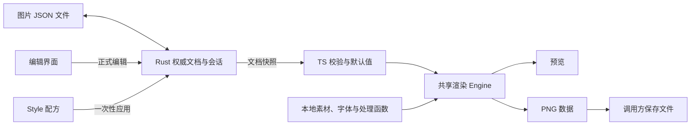

# 架构与需求基线

本文是当前 Tauri 产品的架构入口。需求明细只在下表对应文档中定义；README 记录实现进度，AGENTS.md 记录开发约束。需求成立不表示功能已经完成。

## 文档分工

| 文档 | 唯一负责的内容 |
| --- | --- |
| [文档与文件](document.md) | 图片 JSON 结构、身份、编辑会话、新建、模板复制、保存及外部变化 |
| [渲染](rendering.md) | 参数与默认值、自然布局、输出适配、图文与外观、诊断及出图验收 |
| [资源与复用](resources.md) | 本地素材、字体、处理链、基础图片操作、Style 与模块资源 |

规范描述职责、数据协议和可观察行为，不维护源码目录清单、函数调用示例、内部算法、机器环境配置或历史检查次数。同一规则只维护一份，其他文档通过链接引用。

## 产品边界

产品以独立图片 JSON 为编辑对象，将文字、图片、矩形和组合模块排版为 PNG。用户和 Agent 均可编辑 JSON，应用提供查看、修改、保存、预览与导出流程。

- 一张图片对应一份完整 JSON，可以在任意目录打开；没有固定项目清单或特殊文件名要求。
- 同一目录可存放多份图片。项目说明由使用者维护，应用不生成或覆盖 AGENTS.md。
- 当前格式为 `v0.2.0`。旧 Python 数据和生成图只用于迁移核对，不自动转换为当前格式。
- 本次只开发 Canvas 渲染 Engine 及其公共接口，复用已有文档、校验、资源和图片处理能力。后续 GUI 预览与图片导出共用这组接口，不分别实现合成逻辑。
- Engine 提供 Canvas 渲染结果和 PNG 数据，不负责选择保存路径、覆盖确认或磁盘写入；这些操作由调用方负责，本次不新增 PNG 文件保存接口。
- 本次不开发 GUI、预览窗口或验收页面；全局资源库管理、撤销重做、三方合并、终端入口和单模块独立导出也不属于本次交付范围，不从旧文档推导行为。
- 本次以当前 Windows 环境为范围，不承担跨平台适配或验收要求；其他平台另立任务。
- 本次不新增、修改或运行测试，测试由用户后续安排。文档和源码仍需遵守仓库既定的链接、格式、静态检查及构建约束；这些检查不作为测试验收声明。

## 职责边界

| 部分 | 负责 | 不承担的职责 |
| --- | --- | --- |
| Rust 文档层 | 文档唯一权威状态、JSON 结构读写、身份与版本、文件保护、外部变化、一次性 Style 应用 | 渲染参数业务校验、文字测量、像素布局和图像合成 |
| Rust 平台层 | 本地文件访问、字体枚举、PNG 文件保存等桌面能力 | 另建一套渲染规则或修改用户图文内容 |
| TypeScript 界面 | 用户输入草稿、选择与视图状态、提交编辑、展示预览和诊断 | 把未提交草稿当成已提交文档，独立推导默认值或布局 |
| TypeScript 渲染层 | 统一渲染校验与默认值、资源使用、图片处理、布局、文字排版、合成和 PNG 编码 | 改写源文档、隐式保存、搜索或下载素材 |

渲染采用 Web 绘图能力，在浏览器/WebView 环境执行，不依赖旧 Python 渲染器或 Node.js 运行图片处理。具体线程调度、缓存和文件传输方式由实现选择，不成为需求中的第二套协议。

已确认的尺寸、间距、文字、图片与外观参数应能在后续界面中独立调节，输入、预览和导出使用相同规则。界面可以展示计算结果，但只有用户主动确认的源参数修改才提交文档。

## 数据流与状态归属

- JSON 保存用户内容及显式参数；会话状态、默认值展开、计算尺寸和像素结果不写回 JSON。
- 文件能打开、编辑和保存，不等于满足渲染需求。结构可读写但渲染不合法的文档仍允许修正和保存。
- 渲染使用独立输入，保留原始内容、稳定 ID、来源笔记及扩展数据。Style 应用是用户主动修改文档的操作，区别于渲染时补默认值。
- 各模块独立使用自己的样式和默认值，没有父子样式继承。父背景可透出，父透明度和裁剪作用于子内容，这些是合成关系。

## Engine 的行为契约

- Engine 可以脱离已打开的文档会话调用：输入完整图片 JSON、明确的 JSON 文件目录及资源读取能力，使用明确的处理函数集合。会话标识和版本可作为来源信息传入，不要求 Engine 自行打开文件或查询会话；素材目录不能从进程当前目录或新建基础目录猜测。
- 成功结果包含最终整数像素尺寸、完整图像、模块布局信息和警告；失败提供可定位的错误，不提供可正式导出的部分结果。
- 警告直接随成功结果返回，不要求 Engine 内再确认；是否在界面提示由后续调用方负责。支持取消未完成的渲染，取消后不返回部分图像。
- 诊断和失败处理统一遵循[渲染需求](rendering.md)，界面不得另定一套阻断规则。
- 预览和导出使用相同的校验、资源、处理链、布局及绘制规则。同一输入和同一资源状态的结果一致；界面缩放与设备像素比不改变文档输出尺寸或排版。
- 新版本到来后，旧的异步结果不得覆盖新预览。失败后可以保留上次预览供查看，但必须明确其已过期，不能当成本次成功结果导出。
- 调用方导出必须针对当前明确选定的文档版本；外部变化尚未处理时先解决冲突。Engine 生成 PNG 数据不表示文件已保存，调用方分别报告编码与文件保存结果。
- PNG 编码复用同一次已完成的 Canvas 结果，不再次加载素材或排版；资源随后变化只影响新的渲染请求。调用方不得修改结果画布的像素或尺寸后仍将它当作原结果编码。

## 兼容与范围取舍

当前需求采用固定叶子尺寸、单根网格和本地 `assetPath`，覆盖旧方案的自适应叶子、素材搜索、动态样式名、Python 处理脚本和字体文件方案。兼容保留数据不代表继续执行旧语义。

未列入当前协议的能力属于范围外，不通过猜测旧行为或静默扩展字段改变当前基线。新增需求先更新所属规范，再开发和验收。发现实现与规范不一致时明确记录差异，不因现有代码恰好如此而悄悄改写需求。
