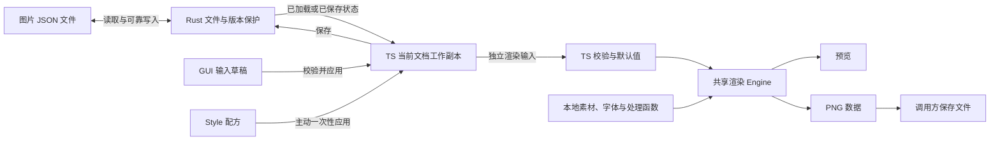

# 架构与需求基线

本文是当前 Tauri 产品的架构入口。需求明细只在下表对应文档中定义；README 记录实现进度，AGENTS.md 记录开发约束。需求成立不表示功能已经完成。

## 文档分工

| 文档 | 唯一负责的内容 |
| --- | --- |
| 本文 | 产品边界、GUI 布局、职责、状态归属及解耦要求 |
| [文档与文件](document.md) | 图片 JSON 结构、workspace、启动、文档切换、编辑、新建、保存及外部变化 |
| [渲染](rendering.md) | 参数与默认值、自然布局、输出适配、图文外观、GUI 预览、诊断及 PNG 导出 |
| [资源与复用](resources.md) | 素材选择与复制、本地字体、处理链、基础图片操作、Style 与模块资源 |

规范描述职责、数据协议和可观察行为，不维护源码目录清单、函数调用示例、内部算法、机器环境配置或历史检查次数。同一规则只维护一份，其他文档通过链接引用。

## 产品边界

产品以独立图片 JSON 为编辑对象，将文字、图片、矩形等最小模块通过父模块的 `layout` 组织并排版为 PNG。用户和 Agent 均可编辑 JSON，应用提供查看、修改、保存、预览与导出流程。

- 一张图片对应一份完整 JSON。底层仍可读写任意位置的独立 JSON；GUI 按用户选择的 workspace 集中管理文档目录，具体规则见文档需求。
- 不要求固定项目清单。项目说明由使用者维护，应用不生成或覆盖 AGENTS.md。
- 当前格式为 `v0.2.0`。旧 Python 数据和生成图只用于迁移核对，不自动转换为当前格式。
- 当前阶段围绕已确认的第一版 GUI 需求接入文档、校验、资源和 Canvas Engine 能力。GUI 预览与图片导出共用渲染逻辑，不分别实现合成器；实现进度见 README。
- Engine 提供 Canvas 结果和 PNG 数据，不负责路径选择、覆盖确认或磁盘写入；GUI 调用方负责导出工作流，Rust 负责可靠文件操作。
- 拖动模块属于文档需求中的后续 TODO；全局资源库管理、撤销重做、三方合并、终端入口和单模块独立导出未纳入本轮 GUI 基线，不从旧文档推导行为。
- 本次以当前 Windows 环境为范围，不承担跨平台适配或验收要求；其他平台另立任务。
- 本次不新增、修改或运行测试，测试由用户后续安排。文档和源码仍需遵守仓库既定的链接、格式、静态检查及构建约束；这些检查不作为测试验收声明。

## 职责边界

| 部分 | 负责 | 不承担的职责 |
| --- | --- | --- |
| Rust 文档与平台层 | JSON 结构读写、加载与保存基线、身份及版本保护、外部变化检测、素材复制、配置读写、字体枚举及 PNG 文件保存 | 承担 GUI 每次未保存编辑，执行渲染参数业务校验或像素合成 |
| TypeScript 编辑应用层 | 当前文档工作副本、模块增删和结构编辑、应用与保存流程、未保存状态、渲染调度、文档与 Engine 的适配 | 因每次编辑而调用 Rust 写 JSON，绕过文件冲突和版本保护 |
| GUI 组件 | 输入草稿、模块选择、展示属性、预览和诊断，发出编辑意图 | 直接依赖图片 JSON 字段路径或 Engine 内部数据结构，另定默认值与布局规则 |
| TypeScript 渲染层 | 统一渲染校验与默认值、资源使用、图片处理、布局、文字排版、合成和 PNG 编码 | 改写源文档、隐式保存、搜索或下载素材 |

渲染采用 Web 绘图能力，在浏览器/WebView 环境执行，不依赖旧 Python 渲染器或 Node.js 运行图片处理。具体线程调度、缓存和文件传输方式由实现选择，不成为需求中的第二套协议。

已确认的尺寸、间距、文字、图片与外观参数应能在界面中独立调节，输入、预览和导出使用相同规则。界面可以展示有效默认值和计算结果，但不能因此将它们写入源文档。

## GUI 布局与交互边界

| 区域或能力 | 已确认要求 |
| --- | --- |
| 左侧文档栏 | 展示 workspace 的文档目录名称，点击后在主编辑区打开；扫描和文件选择规则只在文档需求定义 |
| 主编辑区 | 左侧预览，右侧当前模块详情；文档列表与模块列表不是同一概念 |
| 模块选择 | 鼠标在预览中选中模块，一次只选一个；有根模块时，新建或打开文档默认选中根模块 |
| 右侧详情 | 仅展示、编辑当前模块自身的内容和属性，不递归展开子模块详情；编辑子模块须先选中该子模块 |
| 模块树 | 不提供 |
| 父模块导航 | 暂不增加专门选择父模块的按钮或菜单，需要时再讨论 |
| 属性输入与应用 | 点击“应用”才将输入合入 TS 工作副本并刷新预览；非法值在对应字段附近提示并阻止整次应用，输入保留，文档与当前预览不变 |
| 未应用输入 | 切换模块前提示“应用并切换 / 放弃输入并切换 / 取消”；应用失败则留在当前模块 |
| 保存与导出 | 分别遵循文档需求和渲染需求中的已应用内容、素材及文件保护规则 |

GUI 通过编辑意图及界面所需的数据与编辑应用层交互。图片 JSON 的字段映射、Engine 的调用与结果转换集中在衔接边界，协议调整尽量不扩散到界面组件。业务概念本身改变时，相关交互仍可能需要调整，不承诺任意破坏性重构都能保持 GUI 不变。

这里的“不递归展开”约束右侧编辑控件，不要求文件读取或渲染跳过其他模块；完整布局、诊断及 PNG 合成仍遵循渲染需求。

## 数据流与状态归属

- JSON 保存用户内容及显式参数；会话状态、默认值展开、计算尺寸和像素结果不写回 JSON。
- TS 工作副本承载未保存的模块和属性修改；Rust 的已加载、已保存基线不替代这份副本。切换和保存保护分别考虑未应用输入与已应用但未保存的修改。
- 文件能打开、编辑和保存，不等于满足渲染需求。结构可读写但渲染不合法的文档仍允许修正和保存。
- 渲染使用独立输入，保留原始内容、稳定 ID、来源笔记及扩展数据。Style 应用是用户主动修改文档的操作，区别于渲染时补默认值。
- 各模块独立使用自己的样式和默认值，没有父子样式继承。父背景可透出，父透明度和裁剪作用于子内容，这些是合成关系。

## Engine 的行为契约

- Engine 可以脱离已打开的文档会话调用：输入完整图片 JSON、明确的 JSON 文件目录及资源读取能力，使用明确的处理函数集合。会话标识和版本可作为来源信息传入，不要求 Engine 自行打开文件或查询会话；素材目录不能从进程当前目录或新建基础目录猜测。
- 成功结果包含最终整数像素尺寸、完整图像、模块布局信息和警告；失败提供可定位的错误，不提供可正式导出的部分结果。
- 警告直接随成功结果返回，不要求 Engine 内再确认；是否在界面提示由后续调用方负责。支持取消未完成的渲染，取消后不返回部分图像。
- 诊断和失败处理统一遵循[渲染需求](rendering.md)，界面不得另定一套阻断规则。
- 预览和导出使用相同的校验、资源、处理链、布局及绘制规则。同一输入和同一资源状态的结果一致；界面缩放与设备像素比不改变文档输出尺寸或排版。
- 新版本到来后，旧的异步结果不得覆盖新预览。失败后可以保留上次预览供查看，但必须明确其已过期，不能当成本次成功结果导出。
- 调用方导出必须针对当前明确选定的文档版本；外部变化尚未处理时先解决冲突。Engine 生成 PNG 数据不表示文件已保存，调用方分别报告编码与文件保存结果。
- PNG 编码复用同一次已完成的 Canvas 结果，不再次加载素材或排版；资源随后变化只影响新的渲染请求。调用方不得修改结果画布的像素或尺寸后仍将它当作原结果编码。

## 兼容与范围取舍

当前需求采用固定叶子尺寸、单根网格和本地 `assetPath`，覆盖旧方案的自适应叶子、素材搜索、动态样式名、Python 处理脚本和字体文件方案。兼容保留数据不代表继续执行旧语义。

未列入当前协议的能力属于范围外，不通过猜测旧行为或静默扩展字段改变当前基线。新增需求先更新所属规范，再开发和验收。发现实现与规范不一致时明确记录差异，不因现有代码恰好如此而悄悄改写需求。
