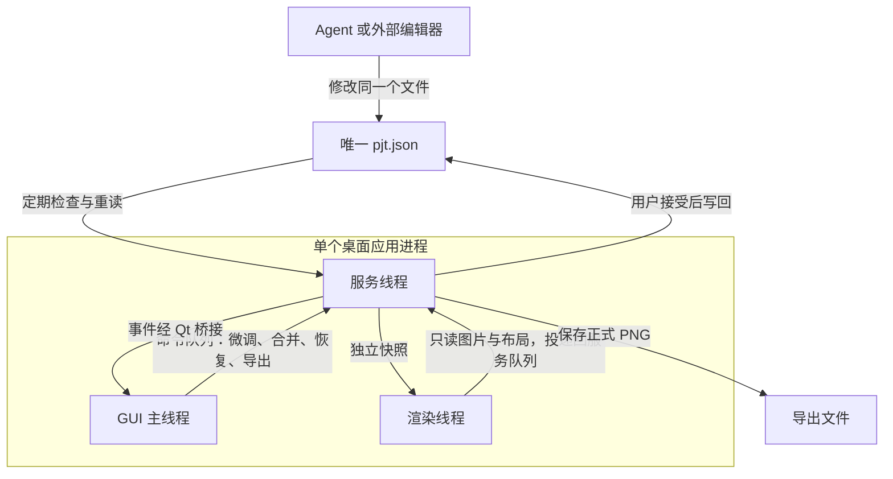

# 一图流攻略制作应用

## 设计依据与模块索引

本文件保留总体流程与共同约束，具体设计拆为三个模块。以下文档与本文件共同构成设计依据；`WEB_EDITOR_REQUIREMENTS.md` 等旧设计已 discard。

| 模块 | 文档 | 职责 |
| --- | --- | --- |
| GUI 主线程 | [PYSIDE6_GUI.md](PYSIDE6_GUI.md) | PySide6 窗口、交互、外部变更审阅、发起导出 |
| Python 服务线程 | [PYTHON_SERVICE.md](PYTHON_SERVICE.md) | 唯一 JSON、文件监听、合并与恢复、内存历史和任务调度 |
| Python 渲染线程 | [PYTHON_RENDERER.md](PYTHON_RENDERER.md) | 快照排版、绘制和合成；渲染请求与结果协议 |

状态：第一版 v0.0.1 已实现，可通过 `python -m image_create_tool open --project <工作目录>` 启动。采用单进程多线程，不使用渲染子进程或跨进程共享内存；撤销历史仅在内存，退出后清空。运行方法见 [README](../README.md)，真实笔记验收见 [tool_test/ACCEPTANCE.md](../tool_test/ACCEPTANCE.md)。

## 目标与创作边界

- 输入：用户攻略笔记与可被 Python 索引的素材目录；输出：可编辑的唯一项目 JSON 和最终 PNG。
- 本机单用户，PySide6 桌面应用，无需 Node.js、浏览器或 HTTP 服务。
- 程序负责素材匹配、校验、测量、换行、布局、保存与合成。Agent 负责理解笔记、拆分模块和生成规则，不计算所有像素坐标。
- 未明确请求创作建议时，Agent 不补充结论、不改推荐、不删减条件，不擅自改变观点、顺序和强调关系；歧义保留原文并标记。
- 默认一列、通常 3–4 行是排版预设，不能据此删字或截断；自动高度可扩展，固定高度溢出明确报告。
- GUI 不内置聊天功能，Agent 无需保持连接；后续 Agent 修改直接通过同一 JSON 被应用发现。

## 单进程与线程边界



- 主线程负责 GUI，用户在主线程点击导出；耗时渲染在渲染线程，文件读写在服务线程，主线程不等待耗时任务。
- 服务线程串行管理当前状态、文件轮询和任务结果，不依赖 PySide6。GUI 桥接器把普通事件转为主线程的 Qt 信号。
- 渲染线程不读变化中的 JSON、不更新控件，只消费独立快照；发布结果后不能修改图片或布局。
- 同进程可传递不可变字节引用，无需共享内存。不能让多个线程同时读写当前文档 dict。
- 文档版本用于异步任务和 GUI 操作校验；外部候选另外使用候选 ID 与内容指纹，不能只依赖外部 JSON 的版本字段。

## 唯一 JSON 与外部修改

应用打开一个工作目录，检查根目录的 `pjt.json`。其中包含字符串字段 `image-create-tool-version` 即识别为本应用项目，当前写入值为 `"v0.0.1"`；文件或标记不存在时视为空项目。解析失败显示问题，不自动覆盖已有文件。

```json
{
  "image-create-tool-version": "v0.0.1",
  "assetsDir": "assets/",
  "outputsDir": "outputs/"
}
```

素材目录和默认输出目录均可自定义，包括工作目录之外的位置；相对路径以工作目录为基准，默认分别为 `assets/` 和 `outputs/`。首版仅做这些配置的持久化，不增加配置文件或版本迁移机制。具体识别和保存规则见服务文档。

项目长期只保存一个 `pjt.json`，其中包含配置、模块、合成规则及必要资源元数据。素材、字体与 PNG 文件可以独立保存；不另外持久保存交接草稿、版本 JSON、素材索引 JSON 或撤销日志。

服务在内存保留基线、当前编辑状态、外部候选、预览与撤销历史，不保存第二份项目副本。首版以 GUI 为主：服务保存 `pjt.json` 时，短暂使用 Windows 共享模式禁止外部普通写入、删除和替换，结束立即释放；平时允许 Agent 编辑。通过同一个受保护句柄检查指纹并原地写入，不将文件锁与临时文件替换混用。锁获取失败保留 GUI 修改并提示重试；具体规则见服务文档。

1. Agent 创建或修改根目录的 `pjt.json`，应用通过“打开工作目录”或 CLI 打开目录；运行后服务持续检测同一路径。
2. GUI 微调通过服务提交，正常情况下写回同一文件并更新预览。
3. 服务发现外部变化后校验并读入候选，暂停自动写回，GUI 显示外部候选与当前效果。
4. 用户选择合并或恢复。合并按字段与稳定 ID 保留双方不冲突修改，冲突需用户选择；恢复默认拒绝外部候选，把当前 GUI 内容写回。
5. 用户确认前重新核对文件指纹，避免应用过期选择。外部再次变化时刷新候选与预览。
6. 正式导出先处理未决候选并保存当前修改，再复用合格图片或渲染固定快照，由服务线程写 PNG。

暂不处理时可继续在内存编辑，必须显示未保存状态。JSON 半写入、解析失败或暂时消失不会清空当前状态。首版不处理 Agent 和 GUI 持续同时修改的复杂场景；保存保护仅覆盖服务写入阶段，Agent 完成一次修改后等待用户处理。原地写入不提供崩溃时的原子保存保证。

内存历史退出后清空；外部候选未处理时关闭或崩溃，之前 GUI 状态不能保证从已被外部修改的唯一文件恢复。这是单份持久数据的取舍，关闭时应先处理或明确放弃。

## 开发顺序与验收

1. 确定文档与操作 Schema，实现独立渲染库。
2. 实现服务线程、单文件保存与监听、外部候选和合并协议，用假渲染器验证。
3. 实现 GUI 交互、比较预览与冲突选择。
4. 接通渲染线程，验证导出、关闭及 Agent 文件修改流程，补齐项目 `AGENTS.md`。

验收重点：仅一个长期项目 JSON；无渲染子进程；外部修改不会被自动保存覆盖；合并/恢复结果正确；撤销只在内存；非法文件保留当前图；候选与当前预览不混用；UI 点击导出不会被耗时任务阻塞。各模块独立验收见对应文档。

