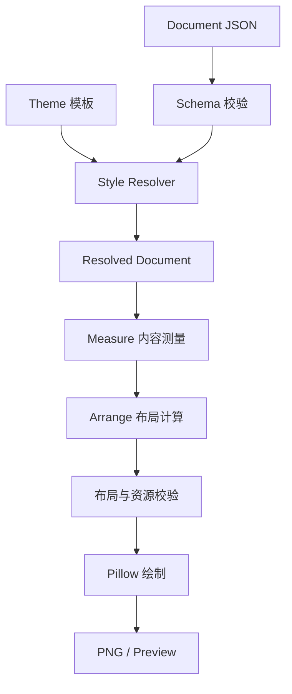

# Creator Tool 文档模型与模板渲染系统重构方案

> 状态：设计草案  
> 适用项目：`leejkee/creator-tool`  
> 目标版本：待定  
> 本文用于指导架构重构，不代表最终确定的 JSON Schema 或 API 协议。

## 1. 背景与现状

Creator Tool 是一款面向游戏攻略图片制作的本地桌面应用。其主要工作流程为：

1. 用户或 LLM 将攻略内容组织为 JSON 文档。
2. 应用解析 JSON，检索对应的图片素材。
3. 渲染器完成文字测量、模块布局、图片绘制和画面合成。
4. GUI 提供预览、手动调整和最终 PNG 导出。

当前项目使用 Python、PySide6 和 Pillow 实现，主要由 GUI、应用服务和渲染器三个部分组成。

现有文档模型已经支持：

- `text`、`image`、`rect`、`group`、`itemRow` 等元素类型。
- `column`、`row`、`fixed` 等布局方式。
- 模块和元素的尺寸、间距及位置偏移。
- 字体、颜色等样式属性。
- 素材引用、图片裁剪、预览和导出。
- 通过 `pjt.json` 保存项目数据，并允许 Agent 直接修改。

这套架构已经具备基础的图文排版能力，但随着游戏专用视觉模板的引入，需要进一步明确文档内容、布局约束和视觉表现之间的职责边界。

## 2. 重构原因

### 2.1 文档结构与视觉样式耦合

当前 JSON 模型允许元素直接包含字号、颜色等样式参数，同时记录布局规则。

虽然这种设计方便直接渲染，但会带来以下问题：

- LLM 需要同时考虑内容组织、位置分配和视觉设计。
- 不同文档可能重复定义相同的字体、颜色与边框。
- 修改整体视觉风格时，需要修改多个元素。
- 同一份攻略难以在不修改内容的情况下切换视觉风格。

因此，有必要将视觉样式从文档结构中进一步分离。

### 2.2 不同攻略无法完全复用固定排版

即使属于同一款游戏，不同攻略的内容结构也可能存在显著差异。

例如：

- 阵容攻略可能包含角色立绘、棋子卡牌和运营文字。
- 棋盘攻略可能包含棋盘截图、站位标记和说明。
- 版本攻略可能包含多组英雄、强度变化和更新说明。

它们可以共享整体视觉语言，但不能保证每个内部模块使用完全相同的排列方式。

因此，**模板不应强制决定整个文档的详细结构**。

更合理的方式是：

- 文档负责描述实际内容和具体排版。
- 模板负责定义内容在指定区域中的视觉表现。
- 可选的布局预设负责复用较稳定的宏观画面结构。

### 2.3 LLM 不适合承担全部视觉设计工作

如果要求 LLM 同时决定文本内容、模块尺寸、图片位置、字体效果、背景、阴影和边框，生成复杂度会明显增加。

此外，视觉参数的微小变化可能造成不可预期的结果，需要频繁进行图像检查与修正。

重构希望缩小 LLM 的职责范围，使其主要关注：

- 攻略内容的理解与组织。
- 模块之间的逻辑关系。
- 每个模块需要展示哪些元素。
- 元素的布局方式和空间分配。

视觉表现则主要依赖由用户维护的模板。

这样既可以提高输出的稳定性，也能够减少 LLM 对图像视觉反馈的依赖。

### 2.4 模板需要支持独立维护和复用

针对《王者万象棋》，预计需要长期维护一些相对稳定的视觉规范，例如：

- 使用角色立绘作为画面上半部分的背景。
- 标题采用统一的字体风格。
- 内容模块使用统一的背景、边框和阴影。
- 不同类型的卡牌应用不同的显示效果。
- 游戏截图、角色图片、卡牌图片使用不同的处理规则。

这些规则应该能够独立于攻略内容存在。

用户可以手动调整模板，也可以借助 LLM 修改模板，而不要求每次生成攻略时重新定义全部视觉参数。

## 3. 重构目标

### 3.1 核心目标

建立一套**文档驱动布局、模板驱动视觉表现**的渲染架构。

文档 JSON 决定：

- 画布尺寸与模块结构。
- 模块的嵌套关系及排列顺序。
- 元素的内容与素材引用。
- 元素所在的空间区域。
- 模块与元素的尺寸约束。
- 固定尺寸、自适应尺寸及剩余空间分配方式。

模板决定：

- 字体、字号、字重与文字颜色。
- 文字在分配区域内的对齐和换行方式。
- 文字描边、阴影和其他装饰效果。
- 图片透明度、圆角、裁剪及适配方式。
- 模块背景、边框、阴影及半透明效果。
- 不同语义类型元素的默认视觉样式。

渲染器负责：

- 解析文档及模板。
- 计算元素最终有效样式。
- 根据布局约束分配空间。
- 测量文字与图片。
- 校验内容溢出和无效约束。
- 完成图像绘制及最终合成。

### 3.2 非目标

本次重构暂不要求：

- 开发完整的 CSS 引擎。
- 实现通用的可视化模板设计器。
- 支持任意复杂的动画或 3D 效果。
- 要求 LLM 生成所有元素的绝对像素坐标。
- 为每种游戏建立独立的渲染器。
- 将当前桌面应用迁移到 Web、SVG 或其他技术栈。

优先复用现有 Python、PySide6 和 Pillow 架构。

## 4. 核心设计原则

### 4.1 内容、布局和样式分离

系统在概念上划分为三个部分。

#### Document：内容与布局

Document 是创作内容的唯一权威数据来源，负责记录模块结构、元素内容和几何约束。

它不需要知道某种字体、边框或背景特效如何实现。

#### Theme：视觉样式模板

Theme 负责为不同类型和语义的节点提供视觉参数。

Theme 可以被多个 Document 复用，也可以独立修改和版本化。

#### Renderer：布局计算与绘制

Renderer 读取 Document 和 Theme，计算最终视觉结果。

两者合并得到的中间结构只存在于内存中，不需要写回原始文档。

### 4.2 模块是空间分配的基本单位

文档使用嵌套的模块或容器组织内容。

模块可以包含：

- 文字。
- 图片。
- 基础形状。
- 其他子模块。

模块负责定义子元素可以使用的区域，以及子元素之间如何排列。

例如：

一个横向模块包含左侧文字区域和右侧图片区域。

JSON 负责决定左侧占多少宽度、右侧占多少宽度，以及两者的间距。

模板只需要决定文字如何在左侧区域中显示，以及图片如何在右侧区域中绘制。

### 4.3 文字区域与文字绘制分离

文字节点应保存：

- 文字内容。
- 所属模块。
- 空间尺寸约束。
- 必要的语义标识。

文字节点不必保存具体字体、字号和颜色。

模板根据文字节点的语义类型，为其选择最终文字样式。

**原则上，文档决定文字可以占据的空间，模板决定文字如何使用这个空间。**

但必须注意：字体与字号会影响文字测量结果。

因此，模板样式需要在布局测量之前解析，不能在全部布局完成之后才叠加。

### 4.4 允许自适应尺寸，但不允许不可控溢出

需要同时支持两种情况。

**固定区域**

文档明确规定元素的宽高。渲染器必须让内容在这个区域内显示，或者报告无法容纳的错误。

适合封面标题、固定尺寸卡牌和标签。

**自适应区域**

文档规定元素宽度，其高度根据实际内容和模板样式计算。

适合攻略正文、说明文字和长度不固定的模块。

对于固定尺寸区域，模板可以指定溢出策略，例如：

- `error`：报告溢出。
- `shrink`：在字号下限内自动缩小文字。
- `clip`：显式裁剪内容。

默认不允许静默删减文字或将字号缩小到不可读的程度。

### 4.5 布局约束优先于视觉装饰

模板可以影响文字测量结果，但原则上不能直接覆盖文档明确规定的几何约束。

例如：

- 模板可以修改字号。
- 模板可以修改文字对齐方式。
- 模板可以修改模块背景和边框。
- 模板不能随意修改元素的 `x`、`y`、`width`、`height`。

如果样式发生变化，导致内容不再适合原来的区域，应重新执行布局测量，并在无法满足约束时报告问题。

需要明确区分：

- **布局约束**：文档要求满足的规则。
- **计算结果**：渲染器最终得到的坐标和尺寸。
- **视觉效果**：模板控制的绘制方式。

## 5. 建议的文档数据结构

建议采用树形场景结构（Scene Graph），允许模块递归包含子元素。

以下是概念示例，并非最终 Schema。

```json
{
  "documentId": "wanxiangqi-guide-001",
  "composition": {
    "width": 1200,
    "height": "auto"
  },
  "modules": [
    {
      "id": "module_1",
      "type": "group",
      "role": "guide_section",
      "layout": {
        "type": "column",
        "width": "fill",
        "height": "auto",
        "padding": 24,
        "gap": 16
      },
      "children": [
        {
          "id": "title_1",
          "type": "text",
          "role": "section_title",
          "content": "阵容推荐",
          "layout": {
            "width": "fill",
            "height": 80
          }
        },
        {
          "id": "content_row",
          "type": "group",
          "layout": {
            "type": "row",
            "width": "fill",
            "height": 220,
            "gap": 16
          },
          "children": [
            {
              "id": "description_1",
              "type": "text",
              "role": "body_text",
              "content": "优先获取核心棋子，再根据局势调整阵容。",
              "layout": {
                "width": "fill",
                "height": "fill"
              }
            },
            {
              "id": "card_1",
              "type": "image",
              "role": "chess_card",
              "assetQuery": {
                "name": "敖隐"
              },
              "layout": {
                "width": 180,
                "height": "fill"
              }
            }
          ]
        }
      ]
    }
  ]
}
```

### 5.1 节点基础字段

建议每个节点具备以下字段：

| 字段 | 作用 |
|---|---|
| `id` | 唯一且稳定的节点标识 |
| `type` | 节点类型 |
| `role` | 可选的语义角色，用于匹配模板 |
| `layout` | 位置和尺寸约束 |
| `children` | 子节点集合，仅容器类型使用 |
| `content` | 内容数据，按节点类型定义 |

图片节点可以继续使用当前项目已有的 `assetId` 和 `assetQuery` 机制。

### 5.2 尺寸约束

建议首先提供：

| 模式 | 含义 |
|---|---|
| `fixed` | 固定逻辑像素尺寸 |
| `auto` | 根据内容计算尺寸 |
| `fill` | 占用父容器可分配的剩余空间 |

百分比、最小最大尺寸及宽高比可以在后续逐步增加。

特别需要规定：

- `fill` 只在父容器有可确定的空间时生效。
- `auto` 的计算不能依赖尚未确定的循环尺寸。
- 无法求解的约束必须报告错误，而不是反复尝试布局。
- 固定位置与自动流式布局应有明确不同的处理规则。

### 5.3 语义角色

建议引入可选的 `role` 字段，例如：

- `main_title`
- `section_title`
- `body_text`
- `hero_image`
- `chess_card`
- `guide_section`

`type` 决定节点的基础能力，`role` 决定节点匹配什么样式。

同一类型的节点可以根据 `role` 应用不同的样式。

未知 `role` 应能够回退到对应节点类型的默认样式。

## 6. 模板系统设计

### 6.1 模板职责

模板主要提供声明式视觉样式。

推荐将其设计为独立资源，而不是将所有视觉参数复制进每个 `pjt.json`。

示例：

```json
{
  "id": "wanxiangqi-dark",
  "version": "1.0.0",
  "styles": {
    "section_title": {
      "fontFamily": "Microsoft YaHei",
      "fontSize": 48,
      "fontWeight": 700,
      "color": "#FFD54A",
      "textAlign": "left",
      "verticalAlign": "center",
      "overflow": "error"
    },
    "body_text": {
      "fontSize": 28,
      "color": "#FFFFFF",
      "wrap": true,
      "overflow": "error"
    },
    "chess_card": {
      "fit": "contain",
      "opacity": 1,
      "border": {
        "width": 4,
        "color": "#D4AF37"
      },
      "cornerRadius": 12
    },
    "guide_section": {
      "background": {
        "type": "solid",
        "color": "#151923",
        "opacity": 0.85
      },
      "cornerRadius": 16
    }
  }
}
```

该结构仅表达建议方向。具体字段需要结合 Pillow 的实际能力进一步确定。

### 6.2 样式匹配

第一版建议只支持简单、确定性的样式匹配规则：

1. 节点类型默认样式。
2. 节点 `role` 对应的样式。
3. 必要时由 GUI 提供明确的局部覆盖值。

不建议一开始引入完整 CSS 选择器、复杂优先级或多级继承系统。

### 6.3 图片处理

图片处理可以由模板声明，但需要区分视觉处理与内容选择。

模板适合控制：

- 透明度。
- 描边与阴影。
- 圆角。
- 背景遮罩。
- 适配方式（`contain`、`cover`）。
- 视觉裁剪策略。

对于必须保留特定区域的图片，例如需要完整展示棋盘站位的截图，文档应允许记录内容层面的裁剪约束或主体保护区域。

模板不能为了实现视觉效果，擅自裁掉具有重要语义的信息。

抠图、复杂蒙版等高成本处理可以在后续通过独立图片处理器实现，并缓存中间产物。

### 6.4 模板版本管理

项目需要能够固定使用的模板版本。

建议：

- 在项目中保存模板 ID 和版本引用。
- 模板作为独立的、可复用的资源文件管理。
- 已发布模板版本不应被静默覆盖。
- 修改模板后允许创建新版本。
- 旧项目应能够继续使用原模板版本渲染。

保持 `pjt.json` 作为单个项目的唯一持久文档；模板文件属于共享资源，不是第二份项目状态。

## 7. 可选的布局预设

仅依靠视觉模板，仍然无法复用游戏攻略中常见的整体画面结构。

因此，可以在后续引入独立的 Layout Preset。

例如万象棋攻略经常使用：

- 上方：角色立绘背景与主标题。
- 中间：阵容展示或主要攻略内容。
- 下方：运营说明和补充信息。

Layout Preset 用于提供初始模块结构和布局约束。

但它与 Theme 的职责不同：

| 组成部分 | 职责 |
|---|---|
| Document | 保存实际内容及其具体排版 |
| Layout Preset | 提供可选的初始结构 |
| Theme | 提供视觉样式 |
| Renderer | 计算最终布局并绘制 |

建议第一版不实现运行时自动注入复杂布局预设。

如果引入预设，优先将其作为**创建文档时的结构初始化工具**，生成可独立编辑的 Document。这样可以避免运行时预设与用户自定义布局产生不可预测的冲突。

## 8. 建议的渲染流程



### 8.1 Style Resolver

新增样式解析层，负责：

- 加载指定模板及其版本。
- 根据节点类型和 `role` 匹配样式。
- 合并默认值和允许的局部覆盖值。
- 检查样式参数是否合法。
- 生成供布局和渲染使用的有效样式。

该过程不应修改原始 Document。

### 8.2 Measure

测量阶段根据有效样式和布局约束，计算节点需要的空间。

例如：

- 根据文字内容、字体、字号和可用宽度计算换行。
- 根据图片尺寸和适配规则计算内容显示范围。
- 根据子节点尺寸和间距计算自适应容器高度。

### 8.3 Arrange

排列阶段根据父子容器的约束计算：

- 节点最终位置。
- 节点最终宽高。
- 文本可绘制区域。
- 图片显示区域。
- 嵌套容器的实际边界。

### 8.4 Paint

绘制阶段使用已经计算完成的布局结果：

- 绘制背景。
- 绘制图片。
- 绘制文字。
- 绘制边框、阴影及其他视觉效果。
- 按层级合成最终图片。

第一版可以保持现有渲染器的整体结构，只在内部逐步形成上述阶段划分。

## 9. 对现有项目的重构建议

### 9.1 优先保留现有能力

建议保留：

- PySide6 GUI。
- 单进程多线程架构。
- Pillow 渲染。
- `pjt.json` 项目存储。
- Agent 外部修改与变更审阅。
- 素材检索和引用。
- 当前的预览、导出和问题报告机制。
- 稳定节点 ID 及撤销/重做机制。

本次重构重点应放在文档 Schema 和渲染内部的数据处理流程，而不是重写整个应用。

### 9.2 文档模型的演进

现有 `modules` 和 `elements` 已经具备层级结构。

建议优先评估如何在现有结构上增加统一的节点语义和布局约束，而不是立即迁移到全新的 JSON 格式。

需要重点处理：

- 模块和组合容器的统一行为。
- `children` 与现有 `elements` 的兼容。
- 现有 `style` 字段如何迁移。
- `itemRow` 等组合组件如何展开。
- 现有 `fixed/row/column` 布局如何保留。
- GUI 对尺寸和文字样式的修改如何映射到新模型。

### 9.3 保留局部覆盖能力

尽管希望将样式主要放入模板，也不建议完全禁止文档的局部样式覆盖。

实际创作中，用户可能需要临时将某个标题改成红色，或者单独缩小某段文字。

建议将这种行为视为明确的例外覆盖，而不是默认样式来源。

覆盖优先级建议为：

`内置默认值 < Theme 样式 < 显式局部覆盖`

局部覆盖只应作用于指定节点，不能隐式修改整个模板。

### 9.4 GUI 应与新的数据模型保持一致

GUI 编辑布局时，应修改 Document 的布局约束。

GUI 编辑字体、颜色、边框时，应明确区分：

- 修改模板中的共享样式。
- 为当前节点添加局部覆盖。

不能让一次局部操作意外改变同一模板下的其他元素。

## 10. 推荐的实施阶段

### 第一阶段：模型与职责边界

目标：确定文档结构、布局约束及样式归属。

任务：

1. 梳理现有 JSON 字段。
2. 将字段分类为内容、布局、样式及运行时计算结果。
3. 明确节点嵌套和尺寸计算规则。
4. 定义 `role` 及样式匹配机制。
5. 制定旧文档兼容策略。

交付物：

- 文档 Schema 草案。
- Theme Schema 草案。
- 字段分类表。
- 兼容与迁移设计。

### 第二阶段：模板解析器

目标：在不改变现有画面语义的情况下引入独立模板。

任务：

1. 实现 Theme 加载和版本识别。
2. 实现 Style Resolver。
3. 将默认样式和原有样式处理逐步迁移到新流程。
4. 确保预览和导出使用相同的有效样式。
5. 测试模板缺失、样式无效等异常情况。

交付物：

- 可独立加载的万象棋主题模板。
- Style Resolver。
- 样式解析单元测试。

### 第三阶段：布局约束完善

目标：让文本和图片按照所属模块分配的空间进行渲染。

任务：

1. 统一 `fixed/auto/fill` 尺寸行为。
2. 明确父子容器的测量顺序。
3. 实现文字区域内的换行、对齐和溢出策略。
4. 处理固定高度和自动高度混合的情况。
5. 验证嵌套容器与位置偏移。

交付物：

- 完整的基础布局计算流程。
- 布局测试样例。
- 可定位的溢出和约束错误。

### 第四阶段：万象棋专用视觉模板

目标：实现首个真实业务场景。

优先选择一个具有代表性的攻略：

- 顶部角色图片与标题。
- 中间阵容展示。
- 底部攻略说明。
- 统一文字风格。
- 卡牌边框与背景效果。

验证同一模板能否处理不同内容数量、不同文字长度和不同图片尺寸。

### 第五阶段：GUI 与 Agent 工作流适配

目标：将新架构融入现有编辑流程。

任务：

1. GUI 支持切换模板。
2. 区分布局属性与视觉样式属性。
3. Agent 可以仅修改内容和布局。
4. 用户可独立维护模板。
5. 模板修改后能正确触发重新渲染及缓存失效。

## 11. 主要风险与设计约束

### 11.1 字号变化导致布局变化

模板字体、字重和字号会改变文字测量结果。

解决方向：

- 先解析样式，再进行内容测量。
- 对自适应容器重新计算高度。
- 对固定容器执行溢出检查。
- 不允许静默删减文本。

### 11.2 自动尺寸约束无法求解

例如父容器高度由子元素决定，而子元素又要求填满父容器高度，可能形成循环依赖。

解决方向：

- 明确定义 `auto/fill` 的合法组合。
- 对不可求解的约束返回错误。
- 第一版避免引入复杂的双向约束求解器。

### 11.3 模板效果改变内容含义

自动裁剪可能截断游戏关键信息，自动插入文本可能改变攻略原意。

解决方向：

- 模板只生成装饰性视觉效果。
- 有语义的图片裁剪和文本内容由 Document 控制。
- 缺失或不明确的信息不由模板自动补全。

### 11.4 新旧 JSON 的兼容性

当前 GUI、服务和渲染器都依赖现有文档协议。

解决方向：

- 渐进式增加字段和功能。
- 避免一次性替换所有节点结构。
- 明确 Schema 版本和迁移入口。
- 使用旧工程进行渲染回归测试。

### 11.5 模板变更造成结果不可复现

相同文档引用的模板如果发生变化，可能导致最终图片不同。

解决方向：

- 固定模板版本。
- 将模板、字体和素材版本纳入资源指纹。
- 更新缓存失效规则。
- 保留旧模板的读取能力。

## 12. 可参考的现代软件工程思路

### 12.1 CSS：内容与表现分离

参考内容：

- 文档内容与样式规则分别维护。
- 根据语义标识匹配样式。
- 使用默认样式与局部覆盖机制。

不需要完整实现 CSS，只借鉴其职责分离与样式解析思想。

参考资料：

- [MDN CSS 基础](https://developer.mozilla.org/en-US/docs/Web/CSS)
- [MDN CSS Box Model](https://developer.mozilla.org/en-US/docs/Learn_web_development/Core/Styling_basics/Box_model)

### 12.2 Flutter：约束驱动布局

参考内容：

- 父节点向子节点传递布局约束。
- 子节点在约束范围内确定尺寸。
- 父节点决定子节点最终位置。

适合设计嵌套模块、固定尺寸和自适应尺寸的求解规则。

参考资料：

- [Flutter 布局约束](https://docs.flutter.dev/ui/layout/constraints)

### 12.3 Scene Graph：树形场景描述

参考内容：

- 使用树形节点表达内容层级。
- 父节点包含子节点。
- 节点具备稳定身份。
- 渲染器递归处理内容及布局。

适合实现可编辑、可组合的图文场景。

### 12.4 Retained-mode UI：保留式界面模型

参考内容：

- 保存声明式文档状态，而不是保存绘制命令序列。
- 内容改变后重新计算受影响的渲染结果。
- 将实际绘制过程视为文档状态的派生结果。

与当前 `pjt.json` 作为项目权威数据源的设计一致。

### 12.5 编译器流水线：分阶段转换

参考内容：

- 校验原始输入。
- 解析模板并构建中间表示。
- 测量和确定布局。
- 执行绘制。

每个阶段具有明确的输入、输出及错误类型，便于测试和调试。

## 13. 验收标准

重构完成后，至少应满足以下要求：

1. 一份有效 Document JSON 可以独立描述内容及布局约束，不依赖某款游戏的专用渲染代码。
2. 同一份 Document 可以切换两套 Theme，而无需改写文字内容、素材引用或显式布局约束。
3. 模板中的字体和视觉效果修改能够反映到最终渲染结果。
4. 固定文字区域能够正确报告内容溢出，或者按明确策略适配。
5. 自适应文字区域能够根据实际内容计算高度。
6. 模块嵌套、排列顺序和显式空间约束保持正确。
7. 模板不能静默修改攻略文字或素材语义。
8. GUI 预览和 PNG 导出具有一致的布局结果。
9. 已保存项目可以通过固定模板版本复现结果。
10. 现有项目文件能够通过兼容层或迁移流程继续使用。

## 14. 总结

本次重构的重点不是增加更多预设样式，而是建立一套职责明确、可扩展的图形文档与渲染系统。

建议将系统长期稳定在以下模型：

**Document = 内容 + 模块结构 + 空间布局约束**

**Theme = 视觉样式 + 区域内部的绘制策略**

**Renderer = 样式解析 + 内容测量 + 布局计算 + 图像绘制**

其中，文档中的模块负责分配空间，文字和图片在所属模块规定的区域中显示，模板负责具体视觉表现。

LLM 主要负责创建和编辑 Document；用户则主要负责维护 Theme，必要时可以让 LLM 辅助调整模板。

布局预设属于可选的文档初始化机制，不需要与视觉模板绑定。

整个系统应优先保证文档结构可靠、布局计算确定、渲染结果可复现，再逐步扩展图片特效、复杂组件和自动化创作能力。

**推荐优先完成文档 Schema 与模板职责边界的设计，再开始实际代码重构。**